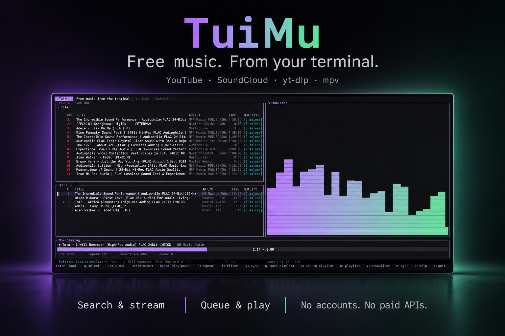

# ♫ TuiMu

A fast, free terminal music player. Search YouTube and SoundCloud, paste any URL that [yt-dlp](https://github.com/yt-dlp/yt-dlp) supports, queue tracks, and play them with [mpv](https://mpv.io/).

No accounts, no logins, no paid APIs.

[](https://github.com/masardon/tuimu)
[](https://github.com/masardon/tuimu/issues)
[](https://github.com/masardon/tuimu/blob/main/LICENSE)

## Sneak Peek



## Requirements

- [Rust](https://www.rust-lang.org/) (2024 edition) to build
- [yt-dlp](https://github.com/yt-dlp/yt-dlp) - finds and extracts audio
- [mpv](https://mpv.io/) - plays audio over JSON IPC
- [curl](https://curl.se/) - used for lyrics lookups and optional Spotify track metadata lookup
- PulseAudio or PipeWire (`parec`) - optional, only needed for the audio visualizer

## Install

### Using Cargo (Recommended)

```bash
git clone https://github.com/masardon/tuimu.git
cd tuimu
cargo build --release
./target/release/tuimu
```

Or run in development: `cargo run`

### Without Cargo (Pre-built Binary)

1. Download the pre-built binary for your Linux distribution from the releases page.
2. Make the binary executable:
   ```bash
   chmod +x tuimu
   ```
3. Move it to a directory in your PATH:
   ```bash
   sudo mv tuimu /usr/local/bin/
   ```
4. Run it from anywhere:
   ```bash
   tuimu
   ```

### Using the Installation Script

One-liner. On Linux it downloads the latest release build; on Termux (Android) it installs the dependencies via `pkg`, downloads a pre-built Android binary when one exists for your architecture (aarch64), and falls back to building from source automatically:

```bash
curl -fsSL https://raw.githubusercontent.com/masardon/tuimu/main/install.sh | bash
```

Or step by step:

1. Download the installation script:
   ```bash
   curl -O https://raw.githubusercontent.com/masardon/tuimu/main/install.sh
   ```
2. Make it executable:
   ```bash
   chmod +x install.sh
   ```
3. Run it:
   ```bash
   ./install.sh
   ```

### Building for Release

Release binaries (`x86_64`, `aarch64`, and `aarch64` for Android/Termux) are built automatically by GitHub
Actions whenever a version tag (`v*`) is pushed; `install.sh` always pulls the
latest one. To cut a release manually:

```bash
# after bumping version in Cargo.toml
git tag v0.1.1
git push origin v0.1.1
```

To build locally instead:

1. Clean caches:
   ```bash
   ./clean-cache.sh
   ```
2. Build the release:
   ```bash
   ./build-release.sh
   ```
3. The script will create a tar.gz archive with the binary and documentation.

## Usage

### Keyboard Shortcuts

| Key | Action |
|-----|--------|
| **?** / **F1** | Toggle help window |
| **@** | Switch between YouTube and SoundCloud |
| **#** / **F3** | Show/hide the lyrics panel |
| **S** | Save the current queue as a playlist |
| **s** | Add the selected result or queue item to a playlist |
| **o** | Browse saved playlists |
| **v** | Show/hide the visualizer |
| **Enter** | Play selected track / Start search |
| **Esc** | Close help / Go to results |
| **Tab** | Switch focus (Search → Results → Queue) |
| **BackTab** | Switch focus in reverse |
| **j/k** | Navigate results/queue |
| **g** | Go to first item |
| **G** | Go to last item |
| **a** | Queue selected track |
| **A** | Queue all tracks |
| **Space** | Play/pause |
| **n/p** | Next/previous track |
| **←/→** | Seek backward/forward |
| **+/-** | Increase/decrease volume |
| **m** | Toggle mute |
| **r** | Cycle repeat mode (off/all/one) |
| **d** | Remove from queue |
| **J/K** | Move queue item down/up |
| **f** | Cycle quality filter |
| **W** | Toggle high-quality-only filter |
| **Q** / **T** | Sort results by quality / duration |
| **q** | Quit (outside the search box) |

While the search box is focused, printable keys (including `q`, `@`, `#`, and `?`) are typed into the query. Switch focus with `Tab` to use those shortcuts.

### Basic Workflow

1. **Search for music**: 
   - Type a search query and press `Enter`
   - Use `@` to switch between YouTube and SoundCloud
   - Paste any URL directly into the search box (YouTube, SoundCloud, Spotify, etc.)

2. **Navigate results**:
   - Use `j`/`k` to navigate through search results
   - Press `Enter` to replace the queue and play the selected track
   - Press `a` to queue a single track
   - Press `A` to queue all tracks

3. **Manage queue**:
   - Switch to the queue with `Tab`
   - Reorder tracks with `J`/`K`
   - Remove tracks with `d`
   - Play with `Enter`

4. **Control playback**:
   - Use `Space` to play/pause
   - Use `n`/`p` for next/previous track
   - Use `←`/`→` to seek
   - Use `+`/`-` to change volume
   - Use `m` to mute
   - Use `r` to cycle repeat modes

5. **View lyrics**:
   - The lyrics panel on the right follows the current track automatically
   - Press `#` (or `F3`) to hide or show the panel
   - The panel shows "Lyrics Unavailable" when no lyrics can be found

6. **Get help**:
   - Press `?` to toggle the help window
   - Press `Esc` to close the help window

7. **Quit**:
   - Press `q` or `Ctrl+C` to quit

## Advanced Features

### Playlists
- Build a queue, then press `S` and type a name to save it
- Press `s` on a search result or queue item to add that track to a saved playlist
- Press `o` to browse saved playlists: `Enter` loads and plays one, `a` appends it to the current queue, `e` inspects its tracks (`d` removes a track), `d` deletes, `r` renames
- Start directly with one: `tuimu --playlist "name"`
- Playlists are stored as JSON under `~/.local/share/tuimu/playlists/` (or `$XDG_DATA_HOME/tuimu/playlists/`) and keep each track's source URL, so they work across sessions

### Visualizer
- Press `v` to toggle the spectrum panel; with the lyrics panel visible it occupies the bottom quarter of the right column
- Audio is tapped from the default output monitor via `parec` (PulseAudio or PipeWire-pulse), so it reflects whatever the desktop is playing
- Without a pulse server the panel shows a note instead of bars; disable it entirely with `--no-visualizer`

### Spotify Integration
Paste a single Spotify track URL - TuiMu pulls the title from Spotify's public oEmbed and matches it to a free YouTube stream (Spotify playback requires login).

### URL Support
- Directly paste any URL that yt-dlp supports
- Handles playlists automatically
- Supports YouTube, SoundCloud, Spotify, and many other platforms

### Environment Variables

- `TUIMU_YTDLP` - override yt-dlp executable (default: `yt-dlp`)
- `TUIMU_MPV` - override mpv executable (default: `mpv`)
- `TUIMU_CURL` - override curl executable (default: `curl`)
- `TUIMU_PAREC` - override parec executable (default: `parec`)
- `TUIMU_PULSEAUDIO` - override pulseaudio executable (default: `pulseaudio`)
- `TUIMU_AO` - force mpv's audio output (e.g. `pulse`, `opensles`). On Termux, `pulse` is selected automatically

### Termux (Android)

TuiMu runs on [Termux](https://termux.dev). Install everything with the one-line installer above, or manually: `pkg install rust binutils git mpv pulseaudio yt-dlp`. Under Termux the app starts the per-user pulseaudio daemon on demand (`module-sles-sink` outputs to the Android speakers) and routes playback through it with `--ao=pulse`, so the visualizer works out of the box. When the `pulseaudio` package is missing, TuiMu falls back to Android's native audio output — playback keeps working, the visualizer just shows a note.

If the panel stays silent despite all this, start the daemon manually and retry (toggle `v` twice):

```bash
pulseaudio --start --load="module-sles-sink" --exit-idle-time=-1
```

## Scripts

### clean-cache.sh
Removes this repository's `./target` build directory. It does not touch global
Cargo, mpv, or yt-dlp caches:
```bash
./clean-cache.sh
```

### install.sh
Downloads the latest pre-built release for your architecture and installs it to
`/usr/local/bin`:
```bash
./install.sh
```

### build-release.sh
Runs the test suite, builds a release binary, and packages it as
`tuimu-linux-<arch>.tar.gz`:
```bash
./build-release.sh
```

## Cache Management

TuiMu does not keep its own application cache. To start a build from scratch,
run `cargo clean` (or `./clean-cache.sh`); deleting global Cargo or media-player
caches is not required.

## Notes

- SoundCloud tracks without a full download are often 30-second previews when unauthenticated. This is a SoundCloud limitation, not a TuiMu bug.
- The quality shown next to each track is an estimate based on title tags and source metadata, not a measurement of the actual stream.
- YouTube stream extraction uses yt-dlp's Android player client for reliability; the app relaunches mpv per source to send the required `Referer` headers without breaking playback.
- All audio extraction goes through yt-dlp and is passed to mpv as a direct URL - no browser session or cookies are used.
- Lyrics are fetched automatically from [LrcLib](https://lrclib.net/) and shown in the right-hand panel; `#` / `F3` hides or shows it. YouTube title clutter ("Official Music Video", "Lirik", "Video Klip", channel suffixes) is stripped before searching, so local-language tracks match their LrcLib entries.
- Printable keys are captured by the search box while it is focused; shortcuts such as `?`, `@`, and `#` are active in the results and queue views.

## Troubleshooting

If you encounter issues:

1. **Ensure all dependencies are installed**:
   ```bash
   # Ubuntu/Debian
   sudo apt-get install rustc yt-dlp mpv curl
   
   # Fedora
   sudo dnf install rust yt-dlp mpv curl
   
   # Arch
   sudo pacman -S rust yt-dlp mpv curl
   ```

2. **Check if executables are in your PATH**:
   ```bash
   which yt-dlp mpv rustc curl
   ```

3. **Try with verbose output**:
   ```bash
   RUST_LOG=debug tuimu
   ```

4. **Reset the application state**:
   ```bash
   rm -rf ~/.local/share/tuimu/
   ```